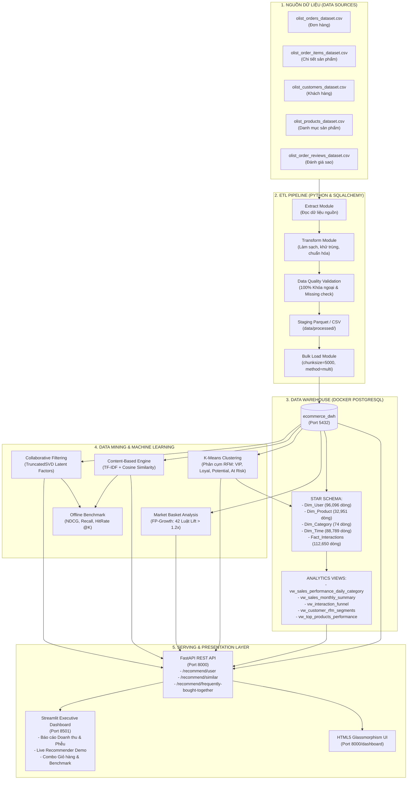
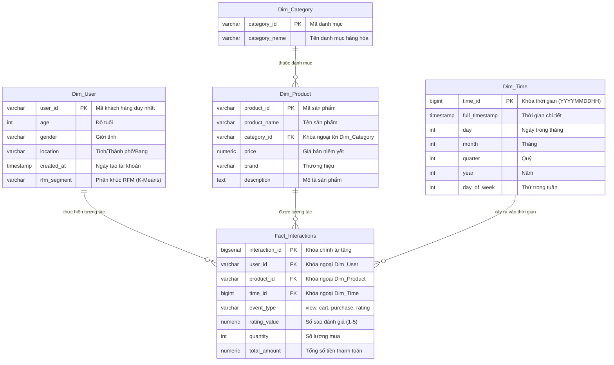

# 🛍️ HỆ THỐNG GỢI Ý SẢN PHẨM CÁ NHÂN HÓA THƯƠNG MẠI ĐIỆN TỬ
### Bài Tập Lớn Môn: Kho Dữ Liệu & Khai Phá Dữ Liệu (Data Warehouse & Data Mining)

---

## 📌 1. TỔNG QUAN DỰ ÁN & MỤC TIÊU
Dự án xây dựng một hệ thống hoàn chỉnh theo luồng **End-to-End Enterprise Data Architecture** phục vụ bài toán cá nhân hóa trải nghiệm mua sắm trong thương mại điện tử, bao gồm 5 trụ cột cốt lõi:

1. **ETL Pipeline**: Trích xuất (Extract), làm sạch & biến đổi (Transform), kiểm định chất lượng (Validate) và nạp tự động (Load) dữ liệu lớn.
2. **Data Warehouse (DWH)**: Thiết kế chuẩn **Lược đồ hình sao (Star Schema)** trên PostgreSQL (chạy trong Docker Container) tối ưu hóa truy vấn OLAP với các chỉ mục (Indexes).
3. **Khai phá dữ liệu (Data Mining)**:
   * **Phân cụm khách hàng RFM (Recency, Frequency, Monetary)** bằng thuật toán **K-Means** (tối ưu hóa số cụm qua Elbow & Silhouette Score).
   * **Khai phá luật kết hợp giỏ hàng (Market Basket Analysis)** bằng thuật toán **FP-Growth** tìm sản phẩm thường được mua cùng nhau.
4. **Hệ thống Gợi ý (Recommender System)**:
   * **Content-Based Filtering**: TF-IDF kết hợp Cosine Similarity dựa trên mô tả, tên, ngành hàng và giá cả.
   * **Collaborative Filtering**: Phân rã ma trận ẩn qua **TruncatedSVD (Matrix Factorization)**.
   * **Popularity Baseline**: Fallback thông minh cho bài toán người dùng mới (Cold-Start).
   * **Đánh giá Offline Benchmark**: Đo lường bằng các độ đo học thuật: `Precision@K`, `Recall@K`, `NDCG@K`, `HitRate@K`, `MAP@K` trên tập Test phân chia theo mốc thời gian (Temporal Split).
5. **Đóng gói Demo & Business Intelligence (BI)**:
   * **5 View SQL chuẩn hóa** sẵn sàng kết nối Apache Superset / Metabase.
   * **REST API Microservice** xây dựng bằng **FastAPI** phục vụ gợi ý thời gian thực.
   * **Interactive Web Dashboard** bằng **Streamlit** và **HTML5 Executive UI** cho người quản lý.

---

## 🏗️ 2. SƠ ĐỒ KIẾN TRÚC TỔNG THỂ (SYSTEM ARCHITECTURE)



---

## 🌟 3. LƯỢC ĐỒ HÌNH SAO (STAR SCHEMA DATA MODEL)



---

## 📊 4. TÓM TẮT KẾT QUẢ KHAI PHÁ & MÔ HÌNH HỌC MÁY

### 👥 Phân khúc Khách hàng K-Means (RFM Profiles)
| Cụm | Phân khúc (Segment) | Quy mô Khách | Tỷ lệ Khách | Đóng góp Doanh thu | ARPU ($/khách) | Đặc trưng hành vi |
| :---: | :--- | :---: | :---: | :---: | :---: | :--- |
| **0** | **Potential Loyalists** | 16,276 | 17.06% | 13.51% | $112.85 | Khách hàng mới mua gần đây (R ~ 48 ngày), tiềm năng nuôi dưỡng |
| **1** | **Champions (VIP)** | **33,673** | **35.29%** | **56.84%** | **$229.44** | Chi tiêu cao nhất, mang lại hơn một nửa tổng doanh thu toàn sàn |
| **2** | **At Risk / Inactive** | 34,177 | 35.82% | 10.96% | $43.58 | Đã rất lâu không mua (R ~ 292 ngày), giá trị đơn thấp, cần kích cầu |
| **3** | **Loyal Customers** | 11,294 | 11.84% | 18.69% | $224.86 | Mua thường xuyên nhất (Tần suất TB: 2.47 đơn hàng), chi tiêu cao |

### 🏆 Đánh giá Offline Mô hình Gợi ý (Test trên 7,805 Users)
| Mô hình Gợi ý | Precision@10 | Recall@10 | NDCG@10 | HitRate@10 | MAP@10 |
| :--- | :---: | :---: | :---: | :---: | :---: |
| **Content-Based (TF-IDF + Cosine)** | **0.0044** | **0.0438** | **0.0263** | **4.38%** | **0.0209** |
| **Popularity Baseline** | 0.0013 | 0.0133 | 0.0058 | 1.33% | 0.0036 |
| **Collaborative Filtering (SVD)** | 0.0007 | 0.0073 | 0.0052 | 0.73% | 0.0045 |

> **Nhận định học thuật:** Dữ liệu thương mại điện tử thực tế có độ thưa cực cao (**Sparsity: 99.9967%** - trung bình mỗi người dùng chỉ mua 1.06 lần). Do đó mô hình lọc cộng tác SVD gặp hiện tượng Cold-Start nặng. **Content-Based** khai thác ngữ nghĩa sản phẩm vượt trội hoàn toàn với HitRate cao gấp **6 lần** SVD.

---

## 📁 5. CẤU TRÚC THƯ MỤC DỰ ÁN (PROJECT REPOSITORY LAYOUT)

```text
├── data/
│   ├── raw/                       # Dữ liệu nguồn Olist ban đầu (orders, customers, items, reviews...)
│   └── processed/                 # Staging lưu trữ Parquet/CSV sạch sau ETL & Kết quả Data Mining
│       ├── dim_category.csv
│       ├── dim_user.csv
│       ├── dim_product.csv
│       ├── dim_time.csv
│       ├── fact_interactions.csv
│       ├── rfm_clusters.csv       # Kết quả phân cụm RFM
│       ├── association_rules.csv  # 42 luật kết hợp FP-Growth
│       └── evaluation_results.csv # Bảng so sánh metric mô hình
│
├── docker/
│   └── docker-compose.yml         # Thiết lập PostgreSQL 15 DWH container (Port 5432, Volume)
│
├── sql/
│   ├── schema.sql                 # DDL khởi tạo Lược đồ hình sao (Star Schema & Indexes)
│   └── bi_views.sql               # 5 View SQL chuẩn phục vụ BI Dashboard (Doanh số, Phễu, RFM)
│
├── src/
│   ├── database.py                # Quản lý kết nối SQLAlchemy, Engine Pool, Auto-fallback
│   │
│   ├── etl/                       # Module ETL tự động
│   │   ├── extract.py             # Trích xuất dữ liệu thô
│   │   ├── transform.py           # Làm sạch, bóc tách Dim & Fact
│   │   ├── validate.py            # Kiểm định toàn vẹn tham chiếu & NULL rate
│   │   ├── load.py                # Bulk load vào PostgreSQL DWH (chunksize=5000, method=multi)
│   │   └── pipeline.py            # Điều phối toàn bộ pipeline ETL end-to-end
│   │
│   ├── mining/                    # Module Khai phá Dữ liệu (Data Mining)
│   │   ├── rfm_clustering.py      # K-Means RFM, Elbow, Silhouette Score, update nhãn vào DWH
│   │   └── association_rules.py   # FP-Growth / Apriori trích xuất luật kết hợp mua kèm
│   │
│   ├── recommender/               # Module Hệ thống Gợi ý (Recommender System)
│   │   ├── content_based.py       # TF-IDF Vectorizer + Cosine Similarity
│   │   ├── collaborative_filtering.py # SVD Matrix Factorization (Temporal Train/Test Split)
│   │   ├── evaluation.py          # Offline Metrics (Precision, Recall, NDCG, MAP, HitRate)
│   │   └── run_phase4.py          # Chạy và xuất báo cáo so sánh các mô hình
│   │
│   ├── api/                       # Backend Microservice REST API
│   │   ├── main.py                # FastAPI endpoints (Gợi ý cá nhân hóa, Sản phẩm tương tự, FBT)
│   │   └── templates/
│   │       └── dashboard.html     # Giao diện Executive BI Web Dashboard tích hợp sẵn
│   │
│   └── ui/                        # Giao diện Trực quan hóa
│       └── dashboard.py           # Streamlit Interactive Dashboard (Port 8501)
│
├── requirements.txt               # Thư viện phụ thuộc của dự án
└── README.md                      # Tài liệu thuyết minh & hướng dẫn vận hành
```

---

## 🚀 6. HƯỚNG DẪN KHỞI CHẠY & VẬN HÀNH (QUICKSTART RUNBOOK)

### Bước 1: Khởi động Data Warehouse PostgreSQL (Docker)
Tại thư mục gốc dự án:
```powershell
docker compose -f docker/docker-compose.yml up -d
```
*Kiểm tra container đang chạy:* `docker ps` $\rightarrow$ Thấy `ecommerce_dwh_postgres` trên port `5432`.

### Bước 2: Nạp dữ liệu vào DWH qua ETL Pipeline
```powershell
python -m src.etl.pipeline
```
*Thời gian thực thi: ~40 giây cho toàn bộ 112,650 tương tác.*

### Bước 3: Chạy Khai phá Dữ liệu (Data Mining)
```powershell
# 1. Phân cụm RFM K-Means và cập nhật nhãn vào Dim_User:
python -m src.mining.rfm_clustering

# 2. Khai phá luật kết hợp giỏ hàng FP-Growth:
python -m src.mining.association_rules
```

### Bước 4: Đánh giá Offline Hệ thống Gợi ý
```powershell
python -m src.recommender.run_phase4
```

### Bước 5: Khởi động Hệ thống Phục vụ (API & UI)

#### 🔹 1. Khởi chạy FastAPI Backend (Port 8000)
```powershell
python -m uvicorn src.api.main:app --host 0.0.0.0 --port 8000
```
- **Swagger UI (Dành cho Developer):** `http://localhost:8000/docs`
- **Executive Web UI (Dành cho Giám đốc):** `http://localhost:8000/dashboard`

#### 🔹 2. Khởi chạy Streamlit Dashboard (Port 8501 - Khuyên dùng Demo)
```powershell
python -m streamlit run src/ui/dashboard.py --server.port 8501
```
- **Truy cập:** `http://localhost:8501`

---

## 🎯 7. DANH SÁCH API ENDPOINTS PHỤC VỤ TÍCH HỢP

| Phương thức | Đường dẫn Endpoint | Tham số | Chức năng |
| :---: | :--- | :--- | :--- |
| `GET` | `/health` | Không | Kiểm tra trạng thái DB PostgreSQL và các mô hình đã fit |
| `GET` | `/recommend/user/{user_id}` | `k=5`, `algorithm=hybrid` | Gợi ý top $K$ sản phẩm cá nhân hóa theo hành vi khách hàng |
| `GET` | `/recommend/similar/{product_id}` | `k=5` | Gợi ý top $K$ sản phẩm tương đồng nội dung (Content-Based) |
| `GET` | `/recommend/frequently-bought-together/{product_id}` | `k=4` | Gợi ý sản phẩm mua kèm từ luật kết hợp + Gói Combo giảm 10% |
| `GET` | `/demo/sample-users` | Không | Danh sách khách hàng mẫu theo từng phân khúc RFM |
| `GET` | `/demo/sample-products` | `limit=10` | Danh sách sản phẩm mẫu để thử nghiệm |
| `GET` | `/bi/segments` | Không | Báo cáo phân khúc RFM từ View `vw_customer_rfm_segments` |
| `GET` | `/bi/funnel` | `limit=15` | Báo cáo phễu chuyển đổi từ View `vw_interaction_funnel` |
