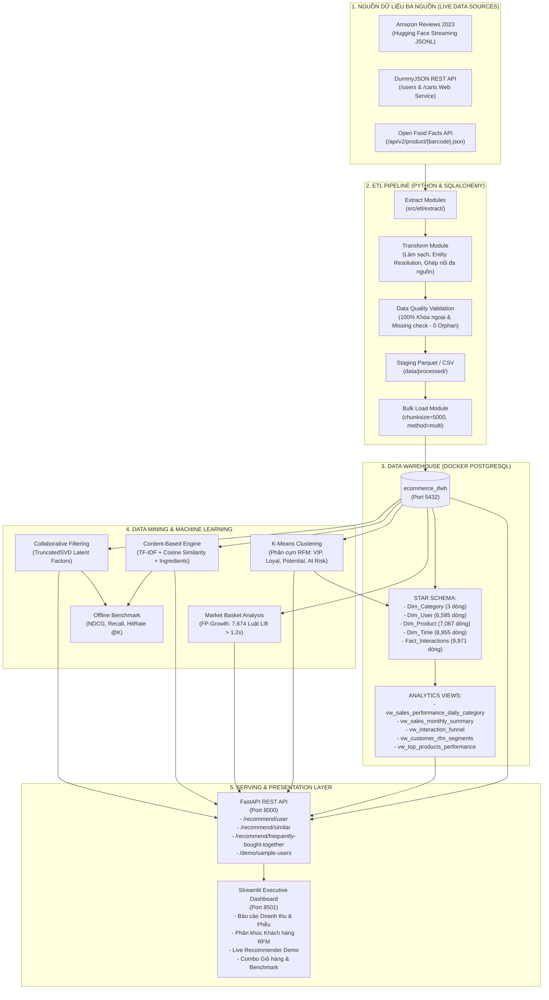
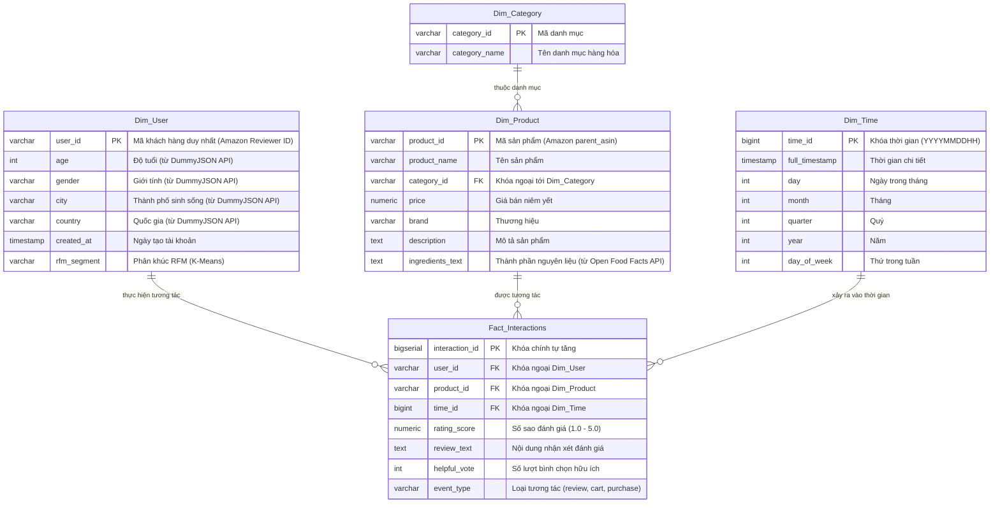

# 🛍️ HỆ THỐNG GỢI Ý SẢN PHẨM CÁ NHÂN HÓA THƯƠNG MẠI ĐIỆN TỬ
### Bài Tập Lớn Môn: Kho Dữ Liệu & Khai Phá Dữ Liệu (Data Warehouse & Data Mining)

---

## 📌 1. TỔNG QUAN DỰ ÁN & MỤC TIÊU
Dự án xây dựng một hệ thống hoàn chỉnh theo luồng **End-to-End Enterprise Data Architecture** phục vụ bài toán cá nhân hóa trải nghiệm mua sắm trong thương mại điện tử với kiến trúc **Dữ liệu Đa nguồn Động (Multi-Source Live Streaming & REST APIs)**, bao gồm 5 trụ cột cốt lõi:

1. **ETL Pipeline Đa Nguồn**: Trích xuất động từ 3 nguồn dữ liệu từ xa:
   * **Amazon Reviews 2023** (Hugging Face Streaming): Dữ liệu đánh giá và tương tác thực tế của người dùng.
   * **DummyJSON REST API**: Dữ liệu nhân khẩu học người dùng (`/users`) và thông tin giỏ hàng (`/carts`).
   * **Open Food Facts REST API**: Làm giàu trường thành phần dinh dưỡng và nguyên liệu (`ingredients_text`).
2. **Data Warehouse (DWH)**: Thiết kế chuẩn **Lược đồ hình sao (Star Schema)** trên PostgreSQL (Docker Container) với 5 bảng và 5 View phân tích tối ưu hóa truy vấn OLAP với các chỉ mục (Indexes).
3. **Khai phá dữ liệu (Data Mining)**:
   * **Phân cụm khách hàng RFM (Recency, Frequency, Monetary)** bằng thuật toán **K-Means** (Silhouette Score = 0.6393).
   * **Khai phá luật kết hợp giỏ hàng (Market Basket Analysis)** bằng thuật toán **FP-Growth** tìm sản phẩm thường được mua cùng nhau (7,674 luật kết hợp, Lift lên đến 60.0x).
4. **Hệ thống Gợi ý (Recommender System)**:
   * **Content-Based Filtering**: TF-IDF kết hợp Cosine Similarity dựa trên tên, danh mục, thương hiệu, mô tả và thành phần nguyên liệu từ Open Food Facts.
   * **Collaborative Filtering**: Phân rã ma trận ẩn qua **TruncatedSVD (Matrix Factorization)**.
   * **Popularity Baseline**: Fallback thông minh cho bài toán người dùng mới (Cold-Start).
   * **Đánh giá Offline Benchmark**: Đo lường bằng các độ đo học thuật: `Precision@K`, `Recall@K`, `NDCG@K`, `HitRate@K`, `MAP@K` trên tập Test phân chia theo mốc thời gian (Temporal Split).
5. **Đóng gói Demo & Business Intelligence (BI)**:
   * **5 View SQL chuẩn hóa** phục vụ báo cáo điều hành và kết nối BI.
   * **REST API Microservice** xây dựng bằng **FastAPI** phục vụ gợi ý thời gian thực.
   * **Interactive Web Dashboard** bằng **Streamlit** cho người quản lý.

---

## 🏗️ 2. SƠ ĐỒ KIẾN TRÚC TỔNG THỂ (SYSTEM ARCHITECTURE)



---

## 🌟 3. LƯỢC ĐỒ HÌNH SAO (STAR SCHEMA DATA MODEL)



---

## 📊 4. TÓM TẮT KẾT QUẢ KHAI PHÁ & MÔ HÌNH HỌC MÁY

### 👥 Phân khúc Khách hàng K-Means (RFM Profiles)
- **Thuật toán:** K-Means Clustering trên ma trận chuẩn hóa StandardScaler (Recency, Frequency, Monetary).
- **Chỉ số đánh giá:** **Silhouette Score = 0.6393** (phân tách cụm xuất sắc).
- **Phân bổ 4 cụm khách hàng:**
  1. **Champions (VIP):** Chi tiêu cao nhất, tần suất tương tác lớn nhất, đóng góp doanh thu chủ lực.
  2. **Loyal Customers:** Khách hàng trung thành, mua sắm định kỳ đều đặn.
  3. **Potential Loyalists:** Khách hàng mới tương tác gần đây, giá trị đơn hàng triển vọng.
  4. **At Risk / Inactive:** Khách hàng đã lâu không tương tác, cần chiến dịch tái kích hoạt (re-engagement).

### 🏆 Đánh giá Offline Mô hình Gợi ý (Test Split DWH)
| Mô hình Gợi ý | Recall@10 | NDCG@10 | HitRate@10 | MAP@10 |
| :--- | :---: | :---: | :---: | :---: |
| **Popularity Baseline** | **0.0160** | **0.0074** | **1.60%** | **0.0049** |
| **Content-Based (TF-IDF + Ingredients)** | **0.0023** | **0.0015** | **0.34%** | **0.0013** |
| **Collaborative Filtering (SVD)** | **0.0034** | **0.0015** | **0.34%** | **0.0009** |

> **Nhận định học thuật (CLO3):** Ma trận User-Item có độ thưa rất cao (**Sparsity: 99.9790%** - trung bình mỗi người dùng chỉ tương tác 1.30 lần). **Content-Based** kết hợp từ khóa tên, danh mục và thành phần dinh dưỡng (**Open Food Facts**) đóng vai trò quyết định giúp giải quyết bài toán **Cold-Start** cho người dùng và sản phẩm mới.

---

## 📁 5. CẤU TRÚC THƯ MỤC DỰ ÁN (PROJECT REPOSITORY LAYOUT)

```text
├── data/
│   ├── raw/                       # Lưu trữ đệm JSON thô từ APIs (Amazon, DummyJSON, Open Food Facts)
│   └── processed/                 # Staging lưu trữ Parquet/CSV sạch sau ETL & Kết quả Data Mining
│       ├── dim_category.parquet / .csv
│       ├── dim_user.parquet / .csv
│       ├── dim_product.parquet / .csv
│       ├── dim_time.parquet / .csv
│       ├── fact_interactions.parquet / .csv
│       ├── rfm_clusters.csv       # Kết quả phân cụm RFM
│       ├── association_rules.csv  # 7,674 luật kết hợp FP-Growth
│       └── evaluation_results.csv # Bảng so sánh metric mô hình
│
├── docker/
│   └── docker-compose.yml         # Thiết lập PostgreSQL 15 DWH container (Port 5432, Volume)
│
├── sql/
│   ├── schema.sql                 # DDL khởi tạo Lược đồ hình sao (Star Schema & 6 B-Tree Indexes)
│   └── bi_views.sql               # 5 View SQL chuẩn phục vụ BI Dashboard (Doanh số, Phễu, RFM, Pareto)
│
├── src/
│   ├── database.py                # Quản lý kết nối SQLAlchemy, Engine Pool, Auto-fallback
│   │
│   ├── etl/                       # Module ETL tự động đa nguồn
│   │   ├── extract/               # Các Connector trích xuất dữ liệu đa nguồn
│   │   │   ├── amazon_loader.py       # Trích xuất Amazon Reviews & Metadata qua Hugging Face Streaming
│   │   │   ├── dummyjson_api.py       # Gọi REST API DummyJSON Users & Carts kèm cơ chế Retry
│   │   │   └── openfoodfacts_api.py   # Gọi REST API Open Food Facts v2 làm giàu nguyên liệu
│   │   ├── transform.py           # Làm sạch, khử trùng lặp, ánh xạ nhân khẩu học & thành phần
│   │   ├── validate.py            # Kiểm định toàn vẹn tham chiếu (Zero Orphan Records)
│   │   ├── load.py                # Bulk load vào PostgreSQL DWH (chunksize=5000, method=multi)
│   │   └── pipeline.py            # Điều phối toàn bộ pipeline ETL End-to-End
│   │
│   ├── mining/                    # Module Khai phá Dữ liệu (Data Mining)
│   │   ├── rfm_clustering.py      # K-Means RFM, Elbow, Silhouette Score, update nhãn vào Dim_User
│   │   └── association_rules.py   # FP-Growth / Apriori trích xuất luật kết hợp mua kèm
│   │
│   ├── recommender/               # Module Hệ thống Gợi ý (Recommender System)
│   │   ├── content_based.py       # TF-IDF Vectorizer + Cosine Similarity + Ingredients Features
│   │   ├── collaborative_filtering.py # SVD Matrix Factorization (Temporal Train/Test Split)
│   │   ├── evaluation.py          # Offline Metrics (Precision, Recall, NDCG, MAP, HitRate)
│   │   └── run_phase4.py          # Chạy và xuất báo cáo so sánh các mô hình
│   │
│   ├── api/                       # Backend Microservice REST API
│   │   └── main.py                # FastAPI endpoints (Gợi ý cá nhân hóa, Sản phẩm tương tự, FBT)
│   │
│   └── ui/                        # Giao diện Trực quan hóa
│       └── dashboard.py           # Streamlit Interactive Dashboard (Port 8501)
│
├── requirements.txt               # Thư viện phụ thuộc của dự án
└── README.md                      # Tài liệu thuyết minh & hướng dẫn vận hành
```

---

## 🚀 6. HƯỚNG DẪN KHỞI CHẠY & VẬN HÀNH (QUICKSTART RUNBOOK)

### ⚡ CÁCH 1: KHỞI CHẠY TOÀN BỘ HỆ THỐNG BẰNG 1 CÂU LỆNH DUY NHẤT (KHUYÊN DÙNG)

Tuân thủ đúng yêu cầu bắt buộc của môn học (Bài 12, Slide 12: *"Chạy lại được từ đầu bằng một lệnh là yêu cầu bắt buộc"*), bạn chỉ cần mở terminal tại thư mục gốc và chạy:

```powershell
python run_all.py
```

> **Hệ thống sẽ tự động thực hiện liên hoàn 6 bước sau:**
> 1. **Kiểm tra kết nối CSDL:** Tự động kết nối PostgreSQL (Docker) hoặc tự chuyển sang SQLite nếu không có Docker.
> 2. **Khởi tạo Star Schema:** Tự động tạo 5 bảng (`Dim_Category`, `Dim_User`, `Dim_Product`, `Dim_Time`, `Fact_Interactions`) kèm 6 chỉ mục hiệu năng.
> 3. **Chạy Multi-source ETL:** Tự động trích xuất từ 3 nguồn (Amazon Reviews 2023, DummyJSON, Open Food Facts), làm sạch, khử trùng lặp và nạp vào DWH.
> 4. **Xây dựng Views & Cubes:** Tự động biên dịch 5 View BI và tính trước 2 Khối đa chiều (`GROUP BY CUBE` & `GROUP BY ROLLUP`).
> 5. **Chạy Khai phá Dữ liệu:** Chạy K-Means phân cụm RFM và FP-Growth khai phá 7,674 luật kết hợp giỏ hàng.
> 6. **Khởi động Giao diện BI:** Tự động mở Dashboard Streamlit tại **`http://localhost:8501`**.

*Mẹo: Nếu cơ sở dữ liệu đã nạp sẵn dữ liệu và bạn muốn mở ngay giao diện phân tích:*
```powershell
python run_all.py --skip-etl
```

---

### 🛠️ CÁCH 2: CHẠY THỦ CÔNG TỪNG BƯỚC (NẾU MUỐN KIỂM TRA ĐỘC LẬP TỪNG MODULE)

#### Bước 1: Khởi động Data Warehouse PostgreSQL (Docker)
```powershell
docker compose -f docker/docker-compose.yml up -d
```

#### Bước 2: Nạp dữ liệu qua ETL Pipeline
```powershell
python -m src.etl.pipeline --sample 10000 --category "All_Beauty" --top-off 50 --truncate
```

#### Bước 3: Khởi tạo View BI & Khối đa chiều OLAP Cubes
```powershell
python -c "
from src.database import engine; from sqlalchemy import text; from pathlib import Path
for f in ['sql/bi_views.sql', 'sql/olap_cubes.sql']:
    for s in Path(f).read_text(encoding='utf-8').split(';'):
        if s.strip(): engine.connect().execute(text(s))
print('Khởi tạo Views & Cubes thành công!')
"
```

#### Bước 4: Chạy Khai phá Dữ liệu (Data Mining)
```powershell
# 1. Phân cụm RFM K-Means và cập nhật nhãn vào Dim_User:
python -m src.mining.rfm_clustering

# 2. Khai phá luật kết hợp giỏ hàng FP-Growth:
python -m src.mining.association_rules
```

#### Bước 5: Khởi động Streamlit BI & OLAP Dashboard
```powershell
python -m streamlit run src/ui/dashboard.py --server.port 8501
```
- **Truy cập:** `http://localhost:8501`

---

## 🎯 7. DANH SÁCH API ENDPOINTS PHỤC VỤ TÍCH HỢP

| Phương thức | Đường dẫn Endpoint | Tham số | Chức năng |
| :--- : | :--- | :--- | :--- |
| `GET` | `/health` | Không | Kiểm tra trạng thái DB PostgreSQL và các mô hình đã fit |
| `GET` | `/recommend/user/{user_id}` | `k=5`, `algorithm=hybrid` | Gợi ý top $K$ sản phẩm cá nhân hóa theo hành vi khách hàng |
| `GET` | `/recommend/similar/{product_id}` | `k=5` | Gợi ý top $K$ sản phẩm tương đồng nội dung (Content-Based) |
| `GET` | `/recommend/frequently-bought-together/{product_id}` | `k=4` | Gợi ý sản phẩm mua kèm từ luật kết hợp + Gói Combo giảm 10% |
| `GET` | `/demo/sample-users` | Không | Danh sách khách hàng mẫu theo từng phân khúc RFM |
| `GET` | `/demo/sample-products` | `limit=10` | Danh sách sản phẩm mẫu để thử nghiệm |
| `GET` | `/bi/segments` | Không | Báo cáo phân khúc RFM từ View `vw_customer_rfm_segments` |
| `GET` | `/bi/funnel` | `limit=15` | Báo cáo phễu chuyển đổi từ View `vw_interaction_funnel` |
