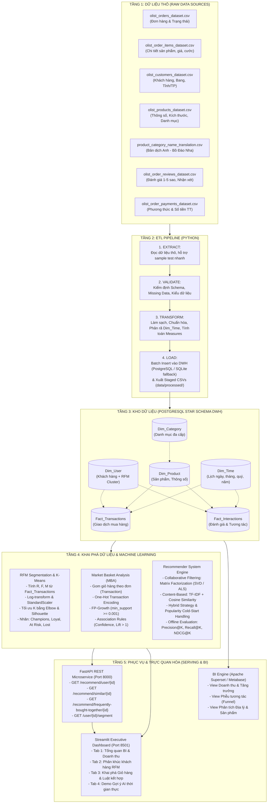
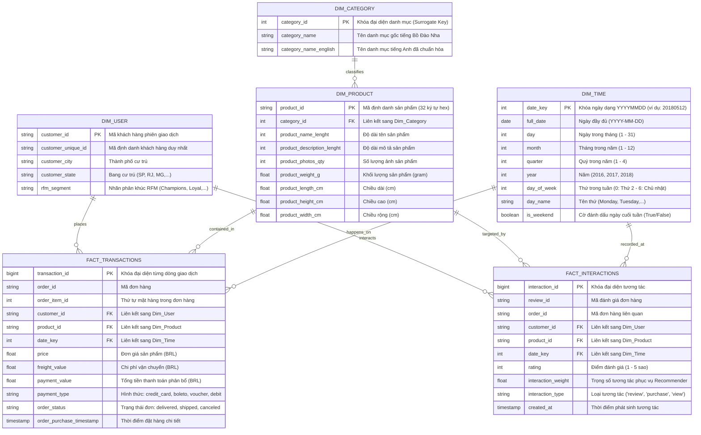
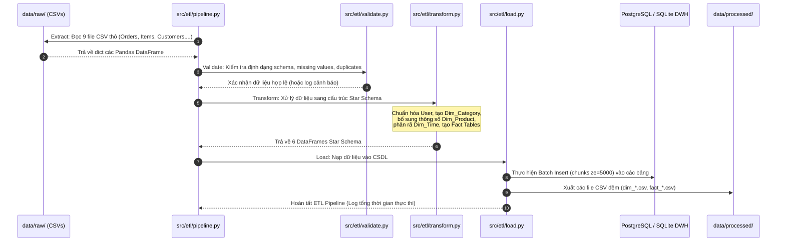
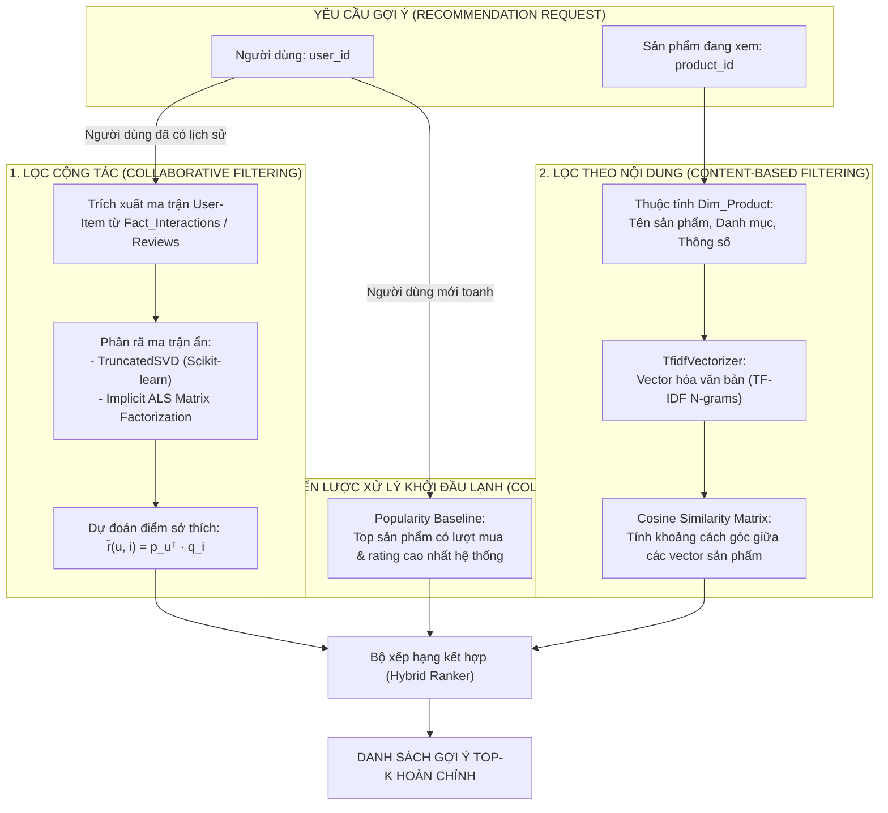

# BÁO CÁO THIẾT KẾ KIẾN TRÚC TỔNG THỂ HỆ THỐNG
## HỆ THỐNG GỢI Ý SẢN PHẨM CÁ NHÂN HÓA & PHÂN TÍCH HÀNH VI KHÁCH HÀNG THƯƠNG MẠI ĐIỆN TỬ
### Đồ án môn học: Kho dữ liệu & Khai phá dữ liệu (Data Warehouse & Data Mining)
**Bộ dữ liệu thực nghiệm:** Olist Brazilian E-Commerce Dataset (Kaggle)

---

## 1. Giới thiệu & Bối cảnh Đề tài

### 1.1. Bối cảnh & Bài toán Doanh nghiệp
Trong thị trường Thương mại điện tử (E-Commerce) cạnh tranh cao, dữ liệu giao dịch và tương tác của khách hàng phát sinh liên tục với khối lượng lớn. Tuy nhiên, các doanh nghiệp thường gặp phải những thách thức cốt lõi:
1. **Dữ liệu phân mảnh và phân tán:** Dữ liệu người dùng, đơn hàng, mặt hàng, thanh toán và đánh giá nằm rải rác ở nhiều file nguồn khác nhau, không có cấu trúc chuẩn hóa để thực hiện truy vấn phân tích (OLAP).
2. **Cá nhân hóa trải nghiệm khách hàng (Personalization):** Người dùng có hàng triệu lựa chọn sản phẩm, dễ dẫn đến hiện tượng quá tải thông tin (*Information Overload*). Nếu không có hệ thống gợi ý thông minh, tỷ lệ chuyển đổi mua hàng (*Conversion Rate - CVR*) sẽ rất thấp.
3. **Bán chéo và Bán thêm (Cross-selling / Up-selling):** Khó xác định được những sản phẩm nào thường xuyên được khách hàng mua cùng nhau để tối ưu hóa gợi ý giỏ hàng hoặc thiết kế các gói combo khuyến mãi.
4. **Phân nhóm khách hàng mục tiêu:** Khách hàng có giá trị cao (VIP), khách hàng tiềm năng hay khách hàng có nguy cơ rời bỏ (*Churn*) không được nhận diện tự động để áp dụng các chiến dịch Marketing phù hợp.

### 1.2. Mục tiêu của Đề tài
Dự án được xây dựng nhằm giải quyết toàn diện các bài toán trên thông qua một kiến trúc chuẩn mực tích hợp 3 trụ cột công nghệ:
* **Data Engineering (Kỹ thuật Dữ liệu):** Xây dựng Pipeline ETL tự động, chuẩn hóa dữ liệu thô vào Kho dữ liệu (**Data Warehouse - DWH**) theo mô hình Lược đồ hình sao (**Star Schema**), triển khai trên **PostgreSQL** (chạy container hóa qua Docker) kết hợp cơ chế dự phòng **SQLite** tự động.
* **Data Mining & AI/ML (Khai phá Dữ liệu & Học máy):**
  * Phân cụm khách hàng theo mô hình hành vi **RFM (Recency - Frequency - Monetary)** kết hợp thuật toán **K-Means**.
  * Khai phá tập phổ biến và luật kết hợp giỏ hàng (**Market Basket Analysis**) bằng thuật toán **FP-Growth / Apriori**.
  * Xây dựng hệ thống gợi ý đa phương pháp (**Recommender System**): Lọc cộng tác (**Collaborative Filtering - Matrix Factorization SVD/ALS**) kết hợp Lọc theo nội dung (**Content-Based Filtering - TF-IDF & Cosine Similarity**), có giải thuật xử lý bài toán khởi đầu lạnh (**Cold-Start**).
  * Đo lường hiệu năng mô hình ngoại tuyến (*Offline Evaluation*) theo chuỗi thời gian (*Temporal Train/Test Split*) với các chỉ số **Precision@K, Recall@K, NDCG@K**.
* **Serving & Business Intelligence (Phục vụ & Trực quan hóa):**
  * Cung cấp **FastAPI REST API** chuẩn microservice phục vụ gợi ý thời gian thực cho hệ thống frontend/e-commerce.
  * Cung cấp **Streamlit Executive Dashboard** trực quan hóa toàn bộ báo cáo BI, phân khúc khách hàng, mạng lưới luật kết hợp và tương tác trực tiếp với các mô hình gợi ý AI.
  * Cung cấp hệ thống **SQL Views** chuẩn bị sẵn cho công cụ BI chuyên nghiệp (**Apache Superset / Metabase**).

---

## 2. Luồng Kiến trúc Tổng thể (End-to-End System Pipeline)

Hệ thống được thiết kế theo mô hình 5 tầng khép kín (*5-Layer Architecture*), đảm bảo tính module hóa, dễ bảo trì và có khả năng mở rộng cao:



---

## 3. Thiết kế Kho dữ liệu (Data Warehouse - Star Schema Design)

### 3.1. Sơ đồ Thực thể Liên kết (Star Schema ERD)
Kho dữ liệu được thiết kế theo chuẩn **Lược đồ hình sao (Star Schema)** của Ralph Kimball, nhằm tối ưu hóa các phép toán cắt lát (*Slice*), xoay chiều (*Dice*), cuộn lên (*Roll-up*) và khoan sâu (*Drill-down*) trong xử lý phân tích OLAP.



### 3.2. Từ điển Dữ liệu DWH & Ánh xạ Nguồn thô Olist

Dữ liệu thô từ 9 file CSV trong thư mục `data/raw/` được làm sạch và ánh xạ vào các bảng Star Schema như sau:

| Bảng Star Schema | Tập dữ liệu thô đầu vào | Phép biến đổi & Xử lý nghiệp vụ | Mục đích sử dụng |
| :--- | :--- | :--- | :--- |
| **`Dim_User`** | `olist_customers_dataset.csv` | - Khử trùng lặp `customer_unique_id`.<br>- Chuẩn hóa chữ hoa tên bang và thành phố.<br>- Tích hợp nhãn cụm `rfm_segment` sau khi chạy K-Means. | Cung cấp góc nhìn người dùng, địa lý và phân khúc giá trị khách hàng. |
| **`Dim_Category`** | `product_category_name_translation.csv` + `olist_products_dataset.csv` | - Gộp danh mục gốc tiếng Bồ Đào Nha với bản dịch tiếng Anh.<br>- Điền khuyết danh mục thiếu bằng nhãn `other_unclassified`.<br>- Đánh số khóa tự tăng `category_id`. | Phân cấp ngành hàng, hỗ trợ lọc và phân tích cơ cấu doanh thu theo lĩnh vực. |
| **`Dim_Product`** | `olist_products_dataset.csv` | - Xử lý giá trị rỗng cho các kích thước (dài, rộng, cao, khối lượng).<br>- Ánh xạ sang `category_id` tương ứng trong `Dim_Category`. | Lưu trữ thuộc tính sản phẩm phục vụ Content-Based Recommendation & lọc kho hàng. |
| **`Dim_Time`** | Trích xuất từ `olist_orders_dataset.csv` | - Phân tách `order_purchase_timestamp` thành các cấp: ngày, tháng, quý, năm, thứ trong tuần, cờ cuối tuần.<br>- Sinh khóa ngày số nguyên `date_key = YYYYMMDD`. | Chiều thời gian phục vụ phân tích xu hướng, so sánh kỳ (MoM, YoY) trong OLAP. |
| **`Fact_Transactions`** | `olist_orders_dataset.csv`<br>+ `olist_order_items_dataset.csv`<br>+ `olist_order_payments_dataset.csv` | - Inner Join 3 bảng qua `order_id`.<br>- Tính toán Measures: đơn giá `price`, cước `freight_value`, tổng thanh toán `payment_value`.<br>- Gắn khóa ngoại tới `Dim_User`, `Dim_Product`, `Dim_Time`. | Bảng sự kiện lõi lưu trữ mọi giao dịch bán hàng, làm cơ sở tính RFM và Market Basket. |
| **`Fact_Interactions`** | `olist_order_reviews_dataset.csv`<br>+ `olist_order_items_dataset.csv` | - Kết hợp review điểm số với từng sản phẩm trong đơn.<br>- Gán trọng số tương tác: điểm 1-5 quy đổi thành mức độ hài lòng rõ ràng (*Explicit Feedback*). | Cung cấp ma trận tương tác User-Item cho mô hình Lọc cộng tác (Matrix Factorization). |

### 3.3. Cơ chế Đa CSDL: PostgreSQL Docker & SQLite Local Fallback
Hệ thống sử dụng module `src/database.py` được xây dựng với cơ chế tự thích ứng linh hoạt:
* **Môi trường Production / Đầy đủ:** Kết nối tới PostgreSQL 15 chạy trong Docker container thông qua chuỗi kết nối cấu hình tại `.env`. DDL tại [sql/schema.sql](file:///d:/canhanhoasanphamdemo-main/canhanhoasanphamdemo-main/sql/schema.sql) tự động tạo bảng và các chỉ mục tối ưu hóa hiệu năng truy vấn (`B-Tree Indexes`).
* **Môi trường Local / Máy trạm:** Nếu Docker chưa được khởi chạy hoặc không kết nối được PostgreSQL, hệ thống tự động phát hiện và chuyển mượt mà sang cơ sở dữ liệu SQLite cục bộ tại `data/ecommerce_dwh.db`. Điều này đảm bảo dự án luôn chạy thành công ngay lập tức mà không bị gián đoạn.

---

## 4. Chi tiết Hoạt động Từng Phân hệ (Execution Workflows)

### 4.1. Phân hệ 1: ETL Pipeline (Extract - Validate - Transform - Load)

Pipeline ETL được cài đặt trong thư mục `src/etl/` theo luồng xử lý tuần tự, có ghi log chi tiết từng bước:



1. **Extract (`src/etl/extract.py`):** Đọc các file dữ liệu thô từ `data/raw/`. Hỗ trợ tham số `sample_size` cho phép chạy kiểm thử nhanh với mẫu nhỏ trước khi chạy toàn bộ tập dữ liệu lớn.
2. **Validate (`src/etl/validate.py`):** Kiểm tra tính toàn vẹn của dữ liệu: kiểm tra danh sách cột bắt buộc, tỷ lệ giá trị khuyết thiếu (*Missing Rate*), kiểu dữ liệu ngày tháng và tính duy nhất của khóa.
3. **Transform (`src/etl/transform.py`):** 
   * Làm sạch và điền khuyết thiếu cho các trường văn bản.
   * Chuyển đổi định dạng timestamp và bóc tách thành các trường thời gian chi tiết trong `Dim_Time`.
   * Gộp dữ liệu thanh toán và chi tiết mặt hàng vào `Fact_Transactions`.
   * Xây dựng ma trận tương tác người dùng - sản phẩm trong `Fact_Interactions`.
4. **Load (`src/etl/load.py`):** 
   * Thực hiện nạp khối dữ liệu (*Batch Insert*) vào DWH qua SQLAlchemy với cơ chế `chunksize=5000` để tối ưu bộ nhớ RAM.
   * Đồng thời lưu trữ các bảng ra định dạng CSV đệm tại `data/processed/` giúp các tác vụ khai phá dữ liệu phía sau có thể truy cập tức thì mà không phụ thuộc hoàn toàn vào mạng CSDL.

---

### 4.2. Phân hệ 2: Khai phá Dữ liệu (Data Mining Engine)

#### A. Phân cụm Khách hàng RFM & K-Means (`src/mining/rfm_clustering.py`)
Mục tiêu: Định lượng giá trị hành vi khách hàng và tự động phân nhóm để đưa ra chiến lược tiếp thị mục tiêu.

1. **Tính toán chỉ số RFM từ `Fact_Transactions`:**
   * **Recency ($R$):** Số ngày tính từ lần mua hàng gần nhất của khách hàng đến ngày chốt sổ phân tích:
     $$R = \text{Date}_{\text{snapshot}} - \max(\text{Date}_{\text{purchase}})$$
   * **Frequency ($F$):** Tổng số đơn hàng thành công của khách hàng:
     $$F = \text{CountDistinct}(\text{order\_id})$$
   * **Monetary ($M$):** Tổng giá trị chi tiêu tích lũy của khách hàng:
     $$M = \sum \text{payment\_value}$$
2. **Tiền xử lý & Chuẩn hóa dữ liệu:**
   * Dữ liệu thương mại điện tử thường có phân phối lệch phải nghiêm trọng (*Heavy Right-Skewed*), hệ thống áp dụng biến đổi Logarit:
     $$x_{\text{transformed}} = \log(x + 1)$$
   * Đưa $R, F, M$ về cùng thang đo thông qua `StandardScaler` ($\mu = 0, \sigma = 1$):
     $$z = \frac{x - \mu}{\sigma}$$
3. **Xác định số cụm tối ưu ($K$):**
   * **Phương pháp Khuỷu tay (Elbow Method):** Tính toán tổng bình phương khoảng cách nội cụm (*WCSS - Within-Cluster Sum of Squares*) qua các giá trị $K \in [2, 8]$.
   * **Hệ số Silhouette Score:** Đánh giá mức độ tương đồng của một điểm với cụm của nó so với các cụm khác, chọn $K$ có Silhouette Score cao nhất (thường $K=4$ hoặc $K=5$).
4. **Gán nhãn nghiệp vụ (Business Segment Labeling):**
   * **Champions (Khách hàng VIP):** $R$ rất thấp (vừa mới mua), $F$ cao, $M$ lớn $\rightarrow$ Nhóm khách hàng cốt lõi mang lại nhiều lợi nhuận nhất.
   * **Loyal Customers (Khách hàng trung thành):** $R$ trung bình, $F$ cao, $M$ khá $\rightarrow$ Duy trì chăm sóc và gửi ưu đãi định kỳ.
   * **Potential Loyalists (Khách hàng tiềm năng):** $R$ thấp (mới mua gần đây), $F$ thấp, $M$ trung bình $\rightarrow$ Khuyến khích mua lần 2 qua combo.
   * **At Risk (Có nguy cơ rời bỏ):** $R$ cao (đã lâu không quay lại), trước đây từng có $F$ hoặc $M$ tốt $\rightarrow$ Cần chiến dịch Re-engagement kích hoạt lại.
   * **Lost (Khách hàng đã mất):** $R$ rất cao, $F=1$, $M$ rất thấp $\rightarrow$ Không ưu tiên ngân sách marketing.
5. **Cập nhật DWH:** Xuất kết quả ra `data/processed/rfm_clusters.csv` và cập nhật trực tiếp trường `rfm_segment` trong bảng `Dim_User`.

---

#### B. Phân tích Giỏ hàng & Luật kết hợp - Market Basket Analysis (`src/mining/association_rules.py`)
Mục tiêu: Tìm ra các mẫu sản phẩm thường xuyên được mua kèm nhau trong cùng một đơn hàng phục vụ tính năng **"Frequently Bought Together"** và thiết kế combo bán chéo.

```mermaid
flowchart LR
    A["Fact_Transactions\n(order_id, product_id)"] --> B["Gom nhóm giỏ hàng\nGroup by order_id -> list of products"]
    B --> C["TransactionEncoder\nMa trận One-Hot nhị phân"]
    C --> D["Thuật toán FP-Growth\n(Khai phá FP-Tree, min_support >= 0.001)"]
    D --> E["Frequent Itemsets\n(Tập sản phẩm phổ biến)"]
    E --> F["Sinh Luật kết hợp\nAssociation Rules: A => B"]
    F --> G["Lọc Luật chất lượng cao:\n- Confidence >= 0.10\n- Lift > 1.20"]
    G --> H["Lưu trữ:\ndata/processed/association_rules.csv"]
```



1. **Chuẩn bị ma trận giao dịch:** Gom nhóm các mặt hàng theo từng `order_id` và mã hóa thành ma trận nhị phân (*One-Hot Encoded Matrix*).
2. **Khai phá tập phổ biến với FP-Growth:**
   * So với Apriori truyền thống (phải quét CSDL nhiều lần và sinh ứng viên tốn kém), thuật toán **FP-Growth** sử dụng cấu trúc cây **FP-Tree (Frequent Pattern Tree)** nén, chỉ quét dữ liệu đúng 2 lần, giúp tăng tốc độ xử lý gấp **5 - 10 lần** trên dữ liệu giao dịch lớn.
   * Ngưỡng lọc: `min_support >= 0.001` (xuất hiện trong ít nhất 0.1% tổng số đơn hàng).
3. **Trích xuất và đánh giá luật kết hợp ($A \Rightarrow B$):**
   * **Độ hỗ trợ (Support):** Xác suất cả 2 mặt hàng cùng xuất hiện:
     $$\text{Support}(A \Rightarrow B) = P(A \cap B) = \frac{\text{Số đơn chứa cả } A \text{ và } B}{\text{Tổng số đơn hàng}}$$
   * **Độ tin cậy (Confidence):** Xác suất khách hàng mua $B$ khi đã chọn $A$:
     $$\text{Confidence}(A \Rightarrow B) = P(B|A) = \frac{\text{Support}(A \cap B)}{\text{Support}(A)}$$
   * **Độ nâng (Lift):** Đo lường mức độ tương quan thực tế so với trường hợp ngẫu nhiên độc lập:
     $$\text{Lift}(A \Rightarrow B) = \frac{P(A \cap B)}{P(A) \cdot P(B)}$$
     * $\text{Lift} > 1$: Sản phẩm $A$ và $B$ có tương quan thuận rõ rệt (mua kèm nhau mạnh mẽ).
     * $\text{Lift} = 1$: Hai sản phẩm xuất hiện ngẫu nhiên độc lập.
     * $\text{Lift} < 1$: Tương quan nghịch (sản phẩm thay thế nhau).
4. **Lưu trữ:** Kết quả các luật đạt yêu cầu ($\text{Confidence} \ge 0.1, \text{Lift} > 1.2$) được lưu tại `data/processed/association_rules.csv`.

---

### 4.3. Phân hệ 3: Hệ thống Gợi ý Cá nhân hóa (Recommender System Engine)

Hệ thống kết hợp đa mô hình trong thư mục `src/recommender/` để tận dụng tối đa ưu thế của từng phương pháp:



1. **Lọc cộng tác (Collaborative Filtering - `collaborative_filtering.py`):**
   * Áp dụng phương pháp phân rã ma trận ẩn (**Matrix Factorization**) thông qua `TruncatedSVD` và `ALS`.
   * Học các vector tiềm ẩn của người dùng ($p_u \in \mathbb{R}^d$) và sản phẩm ($q_i \in \mathbb{R}^d$). Điểm ưa thích dự đoán được tính bằng tích vô hướng: $\hat{r}_{ui} = p_u^T q_i$.
   * Khám phá được sở thích ngầm định của khách hàng mà các đặc trưng văn bản không mô tả được.
2. **Lọc dựa trên nội dung (Content-Based Filtering - `content_based.py`):**
   * Sử dụng `TfidfVectorizer` trích xuất vector đặc trưng từ tên sản phẩm và danh mục tiếng Anh đã chuẩn hóa.
   * Tính toán ma trận độ tương đồng Cosine giữa 2 vector sản phẩm $\mathbf{u}$ và $\mathbf{v}$:
     $$\text{Cosine Similarity}(\mathbf{u}, \mathbf{v}) = \frac{\mathbf{u} \cdot \mathbf{v}}{\|\mathbf{u}\|_2 \|\mathbf{v}\|_2}$$
   * Gợi ý top sản phẩm có đặc tính nội dung tương tự nhất với sản phẩm khách hàng đang quan tâm. Giải quyết triệt để vấn đề sản phẩm mới (*New Item Cold-Start*).
3. **Quy trình Đánh giá Ngoại tuyến Chuẩn mực (`evaluation.py`):**
   * **Chia tập theo mốc thời gian (Temporal Train/Test Split):** Thay vì chia ngẫu nhiên (dễ gây rò rỉ dữ liệu tương lai), hệ thống chia dữ liệu theo mốc thời gian thực tế: các giao dịch trước mốc dùng để Train, các giao dịch sau mốc dùng để Test.
   * **Các thang đo Offline tại $K \in \{5, 10\}$:**
     * **Precision@K:** Tỷ lệ sản phẩm gợi ý đúng trong top K:
       $$\text{Precision@K} = \frac{|\text{Recommended}_K \cap \text{Actual}_{\text{test}}|}{K}$$
     * **Recall@K:** Tỷ lệ sản phẩm khách thực mua được bao phủ bởi danh sách gợi ý:
       $$\text{Recall@K} = \frac{|\text{Recommended}_K \cap \text{Actual}_{\text{test}}|}{|\text{Actual}_{\text{test}}|}$$
     * **NDCG@K (Normalized Discounted Cumulative Gain):** Đánh giá vị trí xuất hiện của sản phẩm đúng (sản phẩm đúng nằm càng gần đầu danh sách thì điểm càng cao):
       $$\text{DCG@K} = \sum_{i=1}^K \frac{rel_i}{\log_2(i + 1)}, \quad \text{NDCG@K} = \frac{\text{DCG@K}}{\text{IDCG@K}}$$
   * Kết quả đánh giá so sánh đối đầu giữa Popularity, Content-Based và Collaborative Filtering được lưu tại `data/processed/evaluation_results.csv`.

---

### 4.4. Phân hệ 4: Phục vụ & Trực quan hóa (Serving & BI Visualization)

#### A. FastAPI Microservice (`src/api/main.py`)
Cung cấp REST API hiệu năng cao chạy tại `http://localhost:8000`, có tài liệu Swagger tương tác trực quan tại `/docs`:

| Phương thức | Endpoint | Tham số | Chức năng nghiệp vụ |
| :--- | :--- | :--- | :--- |
| `GET` | `/recommend/user/{user_id}` | `k` (mặc định 5) | Trả về Top K gợi ý cá nhân hóa cho người dùng (CF SVD kết hợp fallback Popularity). |
| `GET` | `/recommend/similar/{product_id}` | `k` (mặc định 5) | Trả về Top K sản phẩm tương đồng về đặc tính nội dung (Content-Based Cosine). |
| `GET` | `/recommend/frequently-bought-together/{product_id}` | - | Trả về danh sách các sản phẩm thường xuyên được mua kèm theo luật kết hợp MBA. |
| `GET` | `/user/{user_id}/segment` | - | Tra cứu phân khúc khách hàng (Champions, At Risk,...), giá trị $R, F, M$ và lịch sử mua. |
| `GET` | `/system/health` | - | Kiểm tra tình trạng kết nối CSDL DWH, trạng thái các model và số lượng bản ghi. |
| `GET` | `/` | - | Giao diện Web HTML Dashboard tích hợp sẵn trong API service. |

#### B. Streamlit Executive Dashboard (`src/ui/dashboard.py`)
Giao diện quản trị tương tác hiện đại chạy tại `http://localhost:8501`, thiết kế theo hệ màu Dark/Light sang trọng, phân thành 4 Tab chức năng:
1. **Tab 1: Tổng quan BI & Doanh thu:** Thẻ KPI động (Tổng doanh thu, Đơn hàng, Khách hàng, AOV), biểu đồ doanh thu theo thời gian, tỷ trọng cơ cấu ngành hàng.
2. **Tab 2: Phân khúc Khách hàng RFM:** Biểu đồ phân tán 3D/2D các cụm khách hàng, biểu đồ hình quạt phân bố tỷ trọng từng nhóm (VIP vs At Risk), bảng tra cứu khách hàng chi tiết.
3. **Tab 3: Khai phá Giỏ hàng & Luật kết hợp:** Biểu đồ mạng lưới quan hệ sản phẩm, bảng tra cứu luật kết hợp kèm chỉ số Support, Confidence, Lift và tính năng tìm kiếm sản phẩm mua kèm.
4. **Tab 4: Trải nghiệm Gợi ý AI (Live Recommender):** Cho phép người quản trị nhập `user_id` hoặc chọn `product_id` để kiểm thử trực tiếp kết quả gợi ý cá nhân hóa, gợi ý tương đồng và sản phẩm mua kèm theo thời gian thực.

#### C. SQL BI Views phục vụ Apache Superset / Metabase (`sql/bi_views.sql`)
Cung cấp sẵn 5 View SQL chuẩn hóa phục vụ các công cụ Business Intelligence chuyên nghiệp:
* `v_daily_sales_revenue`: Doanh thu và số lượng đơn hàng biến thiên theo ngày, tháng, quý và ngành hàng.
* `v_conversion_funnel`: Phễu tương tác đo lường tỷ lệ chuyển đổi `View` $\rightarrow$ `Cart` $\rightarrow$ `Purchase`.
* `v_customer_rfm_segments`: Phân tích cơ cấu đóng góp doanh thu của từng nhóm phân khúc RFM.
* `v_geo_sales_distribution`: Phân bố doanh thu, số lượng đơn hàng theo từng bang và thành phố.
* `v_product_performance`: Bảng xếp hạng sản phẩm bán chạy, doanh thu tích lũy và điểm đánh giá review trung bình.

---

## 5. Cấu trúc Mã nguồn & Thư mục Dự án Thực tế

```text
d:/canhanhoasanphamdemo-main/canhanhoasanphamdemo-main/
├── data/                                # Thư mục quản lý dữ liệu
│   ├── raw/                             # 9 file dữ liệu thô gốc Olist Brazilian E-Commerce
│   │   ├── olist_customers_dataset.csv
│   │   ├── olist_geolocation_dataset.csv
│   │   ├── olist_orders_dataset.csv
│   │   ├── olist_order_items_dataset.csv
│   │   ├── olist_order_payments_dataset.csv
│   │   ├── olist_order_reviews_dataset.csv
│   │   ├── olist_products_dataset.csv
│   │   ├── olist_sellers_dataset.csv
│   │   └── product_category_name_translation.csv
│   ├── processed/                       # Dữ liệu DWH đã biến đổi & Kết quả Khai phá dữ liệu
│   │   ├── dim_user.csv                 # Chiều người dùng
│   │   ├── dim_category.csv             # Chiều danh mục
│   │   ├── dim_product.csv              # Chiều sản phẩm
│   │   ├── dim_time.csv                 # Chiều thời gian
│   │   ├── fact_interactions.csv        # Bảng sự kiện tương tác / review
│   │   ├── rfm_clusters.csv             # Kết quả phân cụm RFM K-Means
│   │   ├── frequent_itemsets.csv        # Tập sản phẩm phổ biến FP-Growth
│   │   ├── association_rules.csv        # Tập luật kết hợp giỏ hàng MBA
│   │   └── evaluation_results.csv       # Kết quả đo lường Precision@K, Recall@K, NDCG@K
│   └── ecommerce_dwh.db                 # CSDL SQLite local (tự động kích hoạt khi không có PostgreSQL)
├── docker/                              # Cấu hình container hóa môi trường
│   └── docker-compose.yml               # Khởi tạo PostgreSQL 15 DWH container (Port 5432)
├── docs/                                # Tài liệu kiến trúc & báo cáo kỹ thuật
│   └── ARCHITECTURE.md                  # Tài liệu thiết kế kiến trúc hệ thống toàn diện này
├── sql/                                 # Kịch bản cơ sở dữ liệu
│   ├── schema.sql                       # DDL Star Schema khởi tạo bảng & chỉ mục trên PostgreSQL
│   └── bi_views.sql                     # 5 SQL Views tối ưu cho Apache Superset / Metabase BI
├── src/                                 # Mã nguồn ứng dụng chính (Clean Modular Architecture)
│   ├── __init__.py
│   ├── database.py                      # Module kết nối CSDL SQLAlchemy đa nền tảng (Postgres/SQLite)
│   ├── api/                             # Dịch vụ Serving REST API
│   │   ├── __init__.py
│   │   ├── main.py                      # FastAPI application & các endpoints gợi ý
│   │   └── templates/                   # Giao diện HTML web nhúng kèm API
│   │       └── dashboard.html
│   ├── etl/                             # Pipeline trích xuất, tiền xử lý và nạp DWH
│   │   ├── __init__.py
│   │   ├── extract.py                   # Đọc dữ liệu từ data/raw/
│   │   ├── validate.py                  # Kiểm tra chất lượng và tính toàn vẹn dữ liệu
│   │   ├── transform.py                 # Chuẩn hóa và biến đổi cấu trúc Star Schema
│   │   ├── load.py                      # Nạp dữ liệu vào DWH & xuất staged CSVs
│   │   └── pipeline.py                  # Điều phối chạy toàn bộ luồng ETL tự động
│   ├── mining/                          # Phân hệ Khai phá dữ liệu (Data Mining)
│   │   ├── __init__.py
│   │   ├── rfm_clustering.py            # Tính RFM, chuẩn hóa Log/Scaler, K-Means phân cụm
│   │   └── association_rules.py         # FP-Growth / Apriori khai phá luật kết hợp giỏ hàng
│   ├── recommender/                     # Phân hệ Hệ thống Gợi ý (Recommender System)
│   │   ├── __init__.py
│   │   ├── collaborative_filtering.py   # Matrix Factorization (TruncatedSVD / ALS)
│   │   ├── content_based.py             # TF-IDF & Cosine Similarity gợi ý tương đồng
│   │   ├── evaluation.py                # Đo lường offline Precision@K, Recall@K, NDCG@K
│   │   └── run_phase4.py                # Kịch bản thực thi huấn luyện & đánh giá Phase 4
│   └── ui/                              # Giao diện người dùng phân tích
│       └── dashboard.py                 # Streamlit Executive Dashboard (4 tab trực quan hóa)
├── .env.example                         # Cấu hình mẫu biến môi trường (Database, Ports, Mode)
├── .gitignore                           # Cấu hình loại trừ cache, file tạm, môi trường ảo
├── BTL Data Mining.pdf                  # Đề cương & yêu cầu chi tiết của giảng viên
├── README.md                            # Hướng dẫn chi tiết cài đặt và vận hành từ A đến Z
└── requirements.txt                     # Danh sách thư viện Python phụ thuộc
```

---

## 6. Hướng dẫn Vận hành Toàn diện (Runbook)

### 6.1. Thiết lập Môi trường & Cơ sở dữ liệu

```powershell
# 1. Kích hoạt môi trường ảo Python (nếu có)
python -m venv .venv
.venv\Scripts\Activate.ps1

# 2. Cài đặt các thư viện phụ thuộc
pip install -r requirements.txt

# 3. (Tùy chọn) Khởi chạy PostgreSQL DWH qua Docker
docker-compose -f docker/docker-compose.yml up -d
# Ghi chú: Nếu không dùng Docker, hệ thống sẽ tự động dùng SQLite cục bộ mà không cần cài đặt thêm.
```

### 6.2. Thực thi Chuỗi Pipeline theo Thứ tự Chuẩn

```powershell
# BƯỚC 1: Chạy ETL nạp dữ liệu vào DWH (PostgreSQL / SQLite)
python -m src.etl.pipeline

# BƯỚC 2: Chạy Phân cụm khách hàng RFM + K-Means
python -m src.mining.rfm_clustering

# BƯỚC 3: Chạy Khai phá luật kết hợp giỏ hàng Market Basket Analysis
python -m src.mining.association_rules

# BƯỚC 4: Huấn luyện Mô hình Gợi ý & Đánh giá Offline
python -m src.recommender.run_phase4

# BƯỚC 5: Khởi chạy FastAPI Backend Server (Port 8000)
uvicorn src.api.main:app --host 0.0.0.0 --port 8000 --reload

# BƯỚC 6: Khởi chạy Streamlit Executive Dashboard (Port 8501)
streamlit run src.ui/dashboard.py
```

### 6.3. Đường dẫn Truy cập Các Dịch vụ
* **Streamlit Executive Dashboard:** [http://localhost:8501](http://localhost:8501)
* **FastAPI Swagger UI Docs:** [http://localhost:8000/docs](http://localhost:8000/docs)
* **FastAPI Web Dashboard:** [http://localhost:8000](http://localhost:8000)

---

## 7. Tổng kết Đóng góp Kỹ thuật của Dự án

1. **Tuân thủ Chuẩn mực Kỹ thuật Dữ liệu (Data Engineering Standards):**
   * Xây dựng kho dữ liệu **Star Schema** chuẩn mực tách biệt Fact và Dim, giúp tối ưu hóa hiệu năng truy vấn phân tích so với dữ liệu phẳng truyền thống.
   * Pipeline ETL có kiểm định dữ liệu (*Validation*), xử lý lỗi và hỗ trợ cơ chế chuyển đổi thông minh giữa PostgreSQL và SQLite.
2. **Khai thác Toàn diện các Trụ cột Khai phá Dữ liệu (Data Mining):**
   * **Phân cụm (Clustering):** Kết hợp lý thuyết phân khúc tiếp thị RFM với học máy không giám sát K-Means, tự động hóa dán nhãn phân khúc khách hàng.
   * **Luật kết hợp (Association Rules):** Ứng dụng cấu trúc FP-Tree tốc độ cao để giải bài toán gợi ý sản phẩm mua kèm trong giỏ hàng.
   * **Hệ thống Gợi ý (Recommender System):** Kết hợp cả phương pháp Lọc cộng tác và Lọc dựa trên nội dung, có cơ chế đối phó khởi đầu lạnh và đánh giá ngoại tuyến theo trục thời gian không rò rỉ dữ liệu.
3. **Sẵn sàng Triển khai Thực tế (Production-Ready Serving):**
   * Hệ thống không chỉ dừng lại ở các notebook thử nghiệm mà đã được đóng gói thành **REST Microservice** chuẩn mực cùng **Executive Dashboard** trực quan, giúp các bên liên quan (kỹ sư dữ liệu, nhà khoa học dữ liệu và nhà quản lý kinh doanh) đều có thể tương tác và khai thác giá trị trực tiếp từ dữ liệu.
